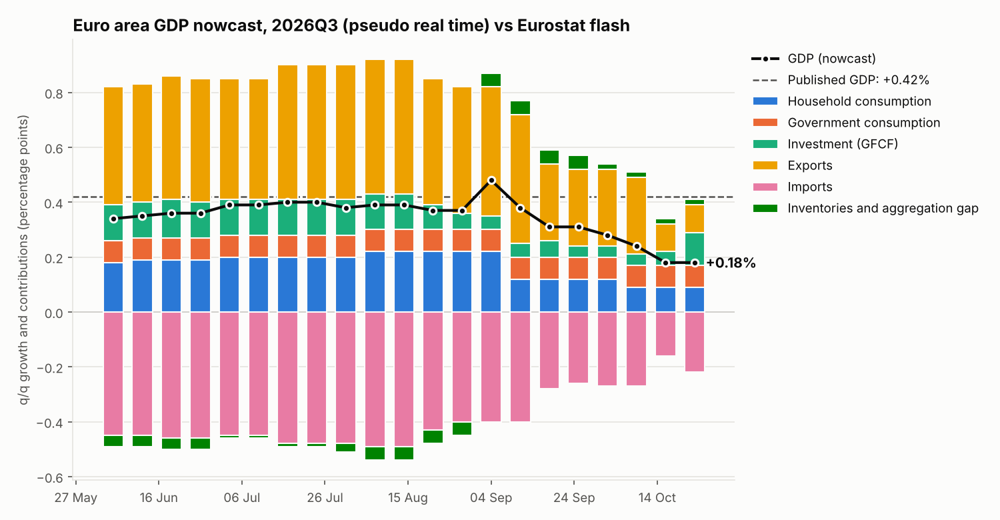

# ea-gdpnow — euro area GDP nowcast by expenditure component

A transposition to the euro area (EA21) of the Atlanta Fed's **GDPNow** approach
([Higgins, 2014](https://fraser.stlouisfed.org//docs/historical/frbatl/wp/frbatl_wp_2014-07.pdf)):
instead of forecasting GDP directly, each demand component is nowcast from its monthly
indicators, and the components are then re-aggregated into contributions to growth.

100% public data (Eurostat API, no key required). Every download is timestamped in a SQLite
database, so true data vintages build up over time.

## Pipeline

```
Eurostat API ──fetch──> SQLite (timestamped observations = vintages)
                              │
                              ▼
        monthly indicators ──ragged-edge filling (one AR per series, or a dynamic factor model)
                              │
                              ▼
              quarterly averages ──one bridge equation per component
                              │       (household consumption, investment, exports, imports;
                              │        AR for government consumption)
                              ▼
     contributions = growth × previous-year nominal share (imports with a negative sign)
       + an "inventories and aggregation gap" block modelled directly in GDP percentage points
                              │
                              ▼
               GDP nowcast, table by component, evolution chart
```

## Installation

```bash
python -m venv .venv && source .venv/bin/activate   # Windows: .venv\Scripts\activate
pip install -e ".[dev]"
pytest                                              # 8 tests, offline
```

## Notebook

`notebooks/01_pipeline_step_by_step.ipynb` walks through the pipeline step by step (data, ragged
edge, one bridge equation with its `summary()`, full nowcast, benchmarks, chart, backtest) by calling
the package's functions. It runs offline on synthetic data (`USE_SYNTHETIC = True`), then on real
data after `eanowcast fetch`. Install with `pip install -e ".[dev,notebook]"`.

`notebooks/02_seance_de_travail.ipynb` (in French) is the day-to-day working notebook: it replaces
the command line (fetch, nowcast, tracking, saved nowcasts and post-release assessment, backtest)
and keeps a dated log in `journal/journal.md`, with each session's tables, charts and an HTML copy
in `outputs/YYYY-MM-DD/`. It runs in VS Code (Python and Jupyter extensions) or JupyterLab, with
the project's `.venv` as kernel.

Rule of thumb: explore in the notebook, change the model in the `.py` files.

## Command-line usage

```bash
eanowcast demo                         # the whole pipeline on synthetic data (offline)
eanowcast fetch                        # download the Eurostat series -> data/eanowcast.sqlite
eanowcast nowcast --save               # nowcast of the current quarter (+ backcast of the previous one)
eanowcast nowcast --method dfm         # fill missing months with a dynamic factor model (DynamicFactorMQ)
eanowcast track --target 2026Q3        # weekly evolution of the nowcast in pseudo real time + PNG
eanowcast backtest --start 2010Q1      # RMSFE by horizon against AR(2), historical mean, direct GDP bridge
eanowcast history --target 2026Q4      # chart of the nowcasts actually saved over time
```

With Docker:

```bash
docker build -t ea-gdpnow .
docker run --rm -v "$PWD/data:/app/data" ea-gdpnow fetch
docker run --rm -v "$PWD/data:/app/data" ea-gdpnow nowcast --save
```

## Data (configured in `src/eanowcast/series.toml`)

| Block | Indicators | Eurostat dataset |
| --- | --- | --- |
| Household consumption | retail trade volume, consumer confidence, retail trade confidence | `sts_trtu_m`, `ei_bssi_m_r2` |
| Government consumption | AR(1) | — |
| Investment (GFCF) | construction output, capital goods production, construction confidence | `sts_copr_m`, `sts_inpr_m`, `ei_bssi_m_r2` |
| Exports | industrial production, export order books | `sts_inpr_m`, `ei_bsin_m_r2` |
| Imports | forecast consumption, investment and exports | outputs of the other bridges |
| Inventories and aggregation gap | stocks of finished products (assessment), AR(1) | `ei_bsin_m_r2` |

National accounts: `namq_10_gdp` (chain-linked volumes for growth, current prices for the weights).

## Evaluation

At each nowcast date (60 and 30 days before the end of the quarter, at quarter end, and 25 days
after), `backtest` rebuilds the data available from the publication lags, re-estimates everything
and compares with published GDP. Outputs: `outputs/metrics.csv` (RMSFE, MAE, RMSFE relative to the
AR(2), Diebold-Mariano test) and `outputs/error_by_component.csv` (contribution error by block, as in
Higgins' table 6). Quarters 2020Q1–2021Q2 are excluded from estimation (configurable) and, by
default, from the scores (`--keep-excluded` to score them); `outputs/backtest.csv` keeps every
quarter.

## Results (data as of 30 October 2026)

**Pseudo-real-time backtest, 2010Q1–2026Q2** (60 quarters, 2020Q1–2021Q2 excluded). RMSFE in
percentage points of quarter-on-quarter GDP growth:

| Horizon | Components | AR(2) | Direct GDP bridge | Components / AR(2) |
| --- | --- | --- | --- | --- |
| 60 days before quarter end | 0.357 | 0.338 | 0.366 | 1.06 |
| 30 days before quarter end | 0.347 | 0.321 | 0.345 | 1.08 |
| Quarter end | 0.286 | 0.321 | 0.303 | 0.89 |
| 25 days after quarter end | **0.268** | 0.321 | 0.291 | **0.83** (Diebold-Mariano p = 0.04) |

- Accuracy improves as monthly data come in; late in the quarter the component model beats the
  AR(2) benchmark significantly.
- Since 2021 it holds up much better than a direct GDP bridge (RMSFE 0.29 vs 0.39 at 25 days after
  quarter end).
- Early in the quarter it does not beat the AR(2): combining it with an anchor model, with a weight
  that depends on the information available (as GDPNow does), is the next step.
- The largest component errors come from investment and imports (Irish intellectual-property
  flows); they largely offset each other in GDP.

**First real-time test, 2026Q3.** Nowcast saved on 26 October 2026: **+0.18%** q/q. Eurostat
preliminary flash on 30 October: **+0.4%** (+0.42% unrounded), against a consensus of about +0.2%.
Most of the gap comes from Ireland (+5.5% q/q, roughly +0.2 point of euro area growth), which no
euro area monthly indicator captures.



## Project structure

| File | Role |
| --- | --- |
| `series.toml` | indicators, Eurostat filters, publication lags, regressors of each block |
| `config.py` | loads `series.toml` |
| `eurostat.py` | Eurostat JSON-stat client |
| `store.py` | SQLite store with vintages |
| `data.py` | download, `Dataset`, pseudo-real-time masking (`as_of`) |
| `fill.py` | ragged-edge filling (AR or dynamic factor) |
| `transforms.py` | monthly to quarterly, nominal weights, historical contributions |
| `nowcast.py` | bridge equations and re-aggregation (`run_nowcast`) |
| `benchmarks.py` | AR(2), historical mean, direct GDP bridge |
| `backtest.py` | pseudo-real-time evaluation, tracking |
| `report.py` | evolution chart, formatted table |
| `cli.py` | command-line interface |
| `synthetic.py` | synthetic data for tests and the demo |

## Known limitations (v1)

- Pseudo real time on the latest vintage: revisions are ignored until the database has built up
  its own vintages.
- Publication lags approximated by a fixed number of days per series.
- No combination of bridge and quarterly BVAR forecasts as in GDPNow yet.
- Investment not split by asset; no foreign trade volumes or car registrations yet.

## References

- Higgins, P. (2014). *GDPNow: A Model for GDP "Nowcasting"*. FRB Atlanta Working Paper 2014-7.
- Baffigi, A., Golinelli, R., Parigi, G. (2004). *Bridge models to forecast the euro area GDP*.
  International Journal of Forecasting, 20(3), 447–460.
- Giannone, D., Reichlin, L., Small, D. (2008). *Nowcasting: The real-time informational content
  of macroeconomic data*. Journal of Monetary Economics, 55(4), 665–676.
- Bańbura, M., Modugno, M. (2014). *Maximum likelihood estimation of factor models on datasets
  with arbitrary pattern of missing data*. Journal of Applied Econometrics, 29(1), 133–160.
