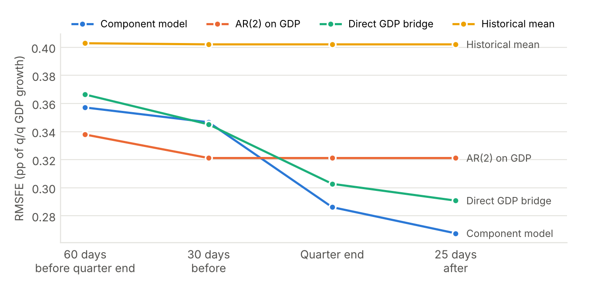
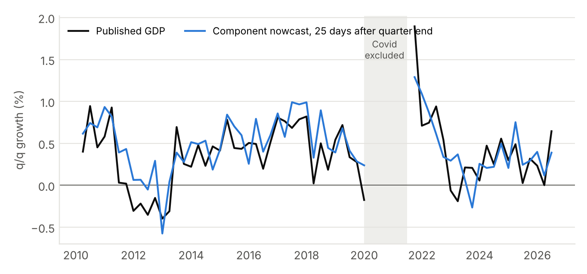
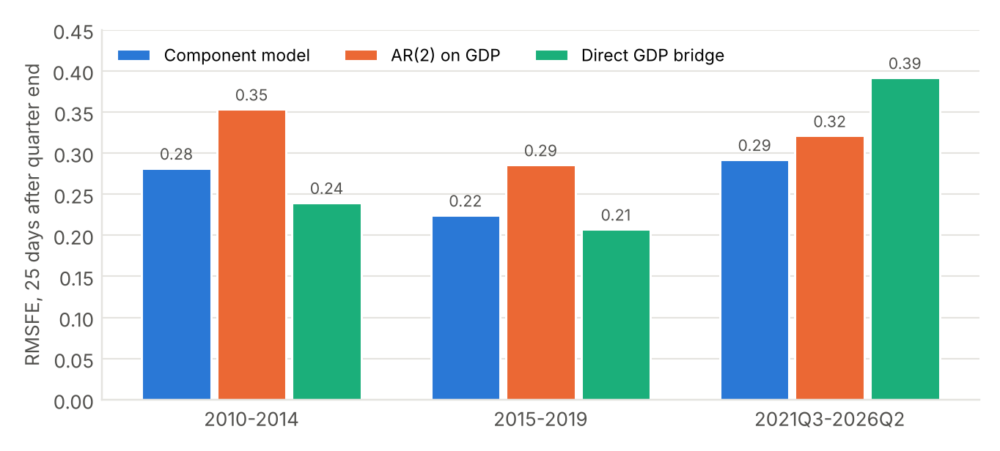
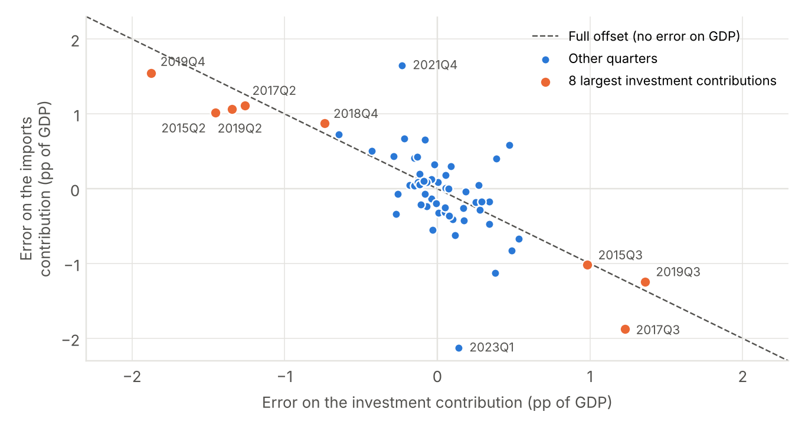
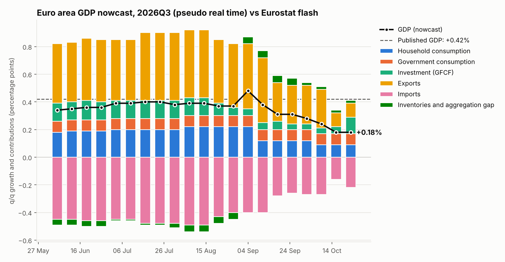

# Results: euro area GDP nowcast by expenditure component

*Data as of 30 October 2026. Eurostat data only, euro area (EA21). Personal project.*

## Summary

- **The model works as a nowcast should.** Its error falls as monthly data come in, from 0.36 to
  0.27 percentage point (pp) of quarterly growth. Late in the quarter it beats an AR(2) on GDP by
  17% (Diebold-Mariano p = 0.04) and explains about 55% of the variance of GDP growth.
- **It is weak early in the quarter.** One to two months before the quarter ends, it does no better
  than the AR(2), because the indicators for the quarter are still mostly extrapolated.
- **It is more robust since Covid.** Against a single regression of GDP on the same indicators, the
  gain is small over 2010–2026, but since 2021 the component model holds up much better (0.29 vs
  0.39 pp).
- **Ireland drives the largest errors.** Irish intellectual-property flows hit investment and
  imports; the two errors largely cancel out in GDP, but not entirely.
- **First real-time test (2026Q3):** +0.18% nowcast on 26 October, +0.4% Eurostat flash on
  30 October. The consensus was about +0.2%. Most of the gap is Ireland (+5.5% q/q).

## 1. The model in one equation

GDP growth is written as the sum of the contributions of five demand components, plus a residual:

$$
y_t \;=\; \sum_{b \in \{C,\,G,\,I,\,X,\,M\}} s_b\, w_{b,t}\, g_{b,t} \;+\; r_t
$$

- $g_{b,t}$: volume growth of component $b$ (household consumption, government consumption,
  investment, exports, imports), quarter on quarter;
- $w_{b,t}$: its share of nominal GDP in the previous year (the euro area's previous-year-prices
  logic); $s_b = -1$ for imports, $+1$ otherwise;
- $r_t$: inventories, valuables and the chain-linking gap, modelled directly in pp of GDP.

Each component has its own bridge equation, estimated by OLS on 2000Q1–2026Q2 (Covid quarters
2020Q1–2021Q2 excluded). Monthly indicators are averaged over the quarter; the months not yet
published are filled with an AR(p) per series (p chosen by AIC).

| Component | Regressors (coefficient, HAC t-stat) | R² |
| --- | --- | --- |
| Household consumption | retail volume 0.49 (3.6), consumer confidence −0.01 (−0.6), retail confidence 0.03 (2.1) | 0.38 |
| Government consumption | own lag 0.14 (1.4) | 0.02 |
| Investment | construction output 0.38 (4.5), capital goods output 0.21 (2.7), construction confidence 0.03 (2.2) | 0.21 |
| Exports | industrial production 0.90 (17.8), export order books 0.01 (1.6) | 0.76 |
| Imports | consumption 0.02 (0.1), investment 0.43 (16.5), exports 0.68 (11.8); predicted values are used when forecasting | 0.88 |
| Inventories and gap (pp) | own lag −0.12 (−1.6), stocks of finished goods −0.03 (−3.8) | 0.15 |

Imports are driven by the *predicted* exports and investment. This creates a useful offset: a 1 pp
error on exports moves GDP by only $w_X - w_M\,\hat\beta_{MX} = 0.486 - 0.450 \times 0.680 = 0.18$
pp instead of 0.49 pp. For investment, the net effect is only 0.02 pp.

Two regressors add nothing (consumer confidence, consumption in the imports equation); they will be
tested for removal in the next version.

## 2. Out-of-sample accuracy

**Protocol.** For each quarter from 2010Q1 to 2026Q2, the nowcast is rebuilt at four dates using
only the data published at that date (fixed publication lags per series), with all equations
re-estimated. It is compared with three benchmarks run on the same information: an AR(2) on GDP, a
direct bridge (GDP on retail sales, industrial production, construction and the economic sentiment
indicator) and the historical mean. Covid quarters are excluded from the scores: 60 quarters.

| Nowcast date | Component model | AR(2) | Direct GDP bridge | Historical mean | Component / AR(2) |
| --- | --- | --- | --- | --- | --- |
| 60 days before quarter end | 0.357 | 0.338 | 0.366 | 0.403 | 1.06 |
| 30 days before quarter end | 0.347 | 0.321 | 0.345 | 0.402 | 1.08 |
| Quarter end | 0.286 | 0.321 | 0.303 | 0.402 | 0.89 |
| 25 days after quarter end | **0.268** | 0.321 | 0.291 | 0.402 | **0.83** |

*RMSFE in pp of quarter-on-quarter GDP growth.*

**Reading.** The error falls by a quarter as hard data for the quarter are released. At 25 days
after quarter end the gain over the AR(2) is significant (Diebold-Mariano statistic 2.09,
p = 0.04); the gain over the direct bridge is not (p = 0.42). Early in the quarter the model is
slightly worse than the AR(2) (not significant). GDPNow solves this by combining its bridge
equations with an anchor model, with a weight that depends on how much of the quarter is known:
that is the main item for the next version.

In sample, the reconstructed GDP has an error of 0.26 pp, almost the same as the out-of-sample
error at 25 days after quarter end (0.268). By then, missing information costs almost nothing: the
limit is the noise in the equations themselves.

## 3. Stability over time

Before 2020 the direct bridge was slightly more accurate. Since 2021 it has broken down (bias of
−0.10 pp) while the component model kept its accuracy: 0.29 pp against 0.39 pp (Diebold-Mariano
p = 0.09) and 0.32 pp for the AR(2) (not significant). A plausible reading is that the link between
GDP and industrial production changed after Covid (services-led recovery, energy shock); in a
component model, a break in one block does not contaminate the others. With 20 quarters, this is
encouraging rather than conclusive.

**Bias.** Over the whole sample the model overestimates growth by 0.09 pp on average (t = 2.7), but
the bias is concentrated in 2010–2019 (+0.13 to +0.15 pp) and is zero since 2021 (−0.006 pp). It
comes from equations estimated, early in the backtest, on short samples dominated by the 2000s
(mainly the residual and government consumption). A real-time bias correction does not reduce the
error, so none is applied.

## 4. Where the errors come from

The forecast error decomposes exactly by component, because the nowcast is a sum of contributions.

| Component (RMSE of the contribution error, pp of GDP) | 60 days before | 30 days before | Quarter end | 25 days after |
| --- | --- | --- | --- | --- |
| Household consumption | 0.29 | 0.28 | 0.28 | 0.27 |
| Government consumption | 0.07 | 0.07 | 0.07 | 0.07 |
| Investment | 0.53 | 0.52 | 0.53 | 0.53 |
| Exports | 0.59 | 0.60 | 0.47 | 0.45 |
| Imports | 0.74 | 0.71 | 0.65 | 0.68 |
| Inventories and gap | 0.31 | 0.31 | 0.31 | 0.31 |
| *GDP* | *0.36* | *0.35* | *0.29* | *0.27* |

Exports benefit from the industrial production data; investment and the residual do not improve at
all. The eight quarters with the largest investment contributions are all known Irish
intellectual-property episodes (2015Q2–Q3, 2017Q2–Q3, 2018Q4, 2019Q2–Q4). These flows are both
invested and imported, so the two errors move in opposite directions (correlation −0.75): in
2019Q4, −1.87 pp on investment, +1.54 pp on imports, +0.41 pp on GDP.

## 5. First real-time test: 2026Q3

The nowcast was saved in the database on 26 October 2026, four days before Eurostat's preliminary
flash estimate.

| | 2026Q3, q/q |
| --- | --- |
| **Component model (26 October)** | **+0.18%** |
| AR(2) on GDP | +0.50% |
| Direct GDP bridge | +0.07% |
| Consensus | about +0.2% |
| **Eurostat flash (30 October)** | **+0.4%** (+0.42% unrounded) |

The nowcast fell from about +0.4% in August to +0.18% as July and August data came in: weak retail
sales (consumption) and weak industrial production (exports, partly offset by lower imports).

The error (−0.23 pp) is within the model's usual range (RMSFE 0.27 pp at this horizon) and close to
the consensus error. Most of it comes from Ireland: +5.5% q/q in the flash, which with a weight of
about 3.5–4% of euro area GDP adds roughly 0.2 pp to euro area growth. Germany (+0.2%), France
(−0.1%) and Italy (0.0%) were weak; excluding Ireland, euro area growth was around 0.2%, close to
the nowcast. This is the weakness already identified in the backtest. The component breakdown of
2026Q3, due in early December, will show which blocks missed.

## 6. Limitations and next steps

- The backtest uses the latest data vintage: revisions are ignored, so real-time errors will be
  somewhat larger. The database now stores every download, so true vintages are building up.
- Publication lags are approximated by a fixed number of days per series.
- Next steps: (1) combine the bridge equations with an anchor model (AR(2), then a quarterly BVAR)
  with horizon-dependent weights; (2) treat Ireland separately (euro area excluding Ireland plus an
  Irish block, or investment and imports jointly); (3) remove the two uninformative regressors and
  re-run the backtest; (4) schedule the weekly run (Airflow).

Methodology reference: Higgins, P. (2014), *GDPNow: A Model for GDP "Nowcasting"*, Federal Reserve
Bank of Atlanta Working Paper 2014-7.
